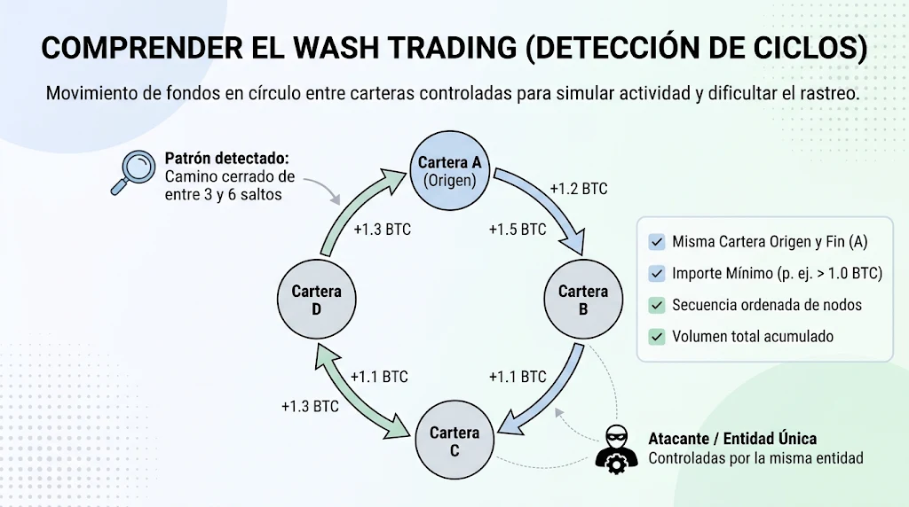
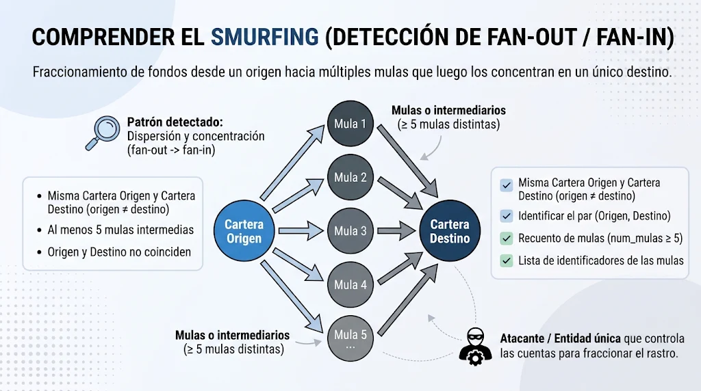
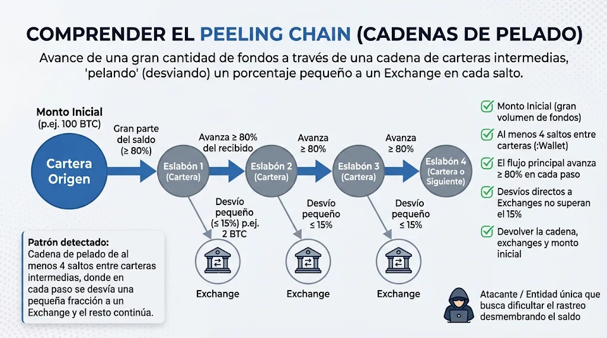

```
------------- ESPECIALIZACIÓN EN INTELIGENCIA ARTIFICIAL Y BIG DATA -------------
---------------------------------------------------------------------------------

Módulo:                     SISTEMAS DE BIG DATA
Profesor:                   Víctor J. González
Unidad de Trabajo:          UT02. Persistencia documental, caché y procesamiento ETL
Reto:                       2. ChainTrace: Rastreo de fondos y topología de grafos en Blockchain
Duración:                   5 semanas (10 horas presenciales + trabajo en equipo)
Resultados de aprendizaje:  RA1 (Criterios a, b, e). Integración de fuentes heterogéneas, construcción de datos complejos y selección de arquitecturas NoSQL.
                            RA3 (Criterios e). Extracción y almacenamiento políglota, eficiencia en valor analítico, contenerización y seguridad/normativa de datos.
                            RA4 (Criterios a, e). Aplica herramientas para la visualización de datos utilizadas en las soluciones Big Data facilitando las tareas de análisis y presentación de resultados.
```

# Reto 2: CHAINTRACE. RASTREO DE FONDOS Y TOPOLOGÍA DE GRAFOS EN BLOCKCHAIN


## 1. Contexto del reto

El protocolo descentralizado *NovaSwap* ha sufrido un drenaje de fondos. Los atacantes están dispersando el botín a través de una red de carteras puente (*mulas*), mezcladores (*mixers*) y transacciones circulares antes de retirar el dinero en casas de cambio sin verificación de identidad (**Exchanges No-KYC**).

Vuestro equipo actúa como la unidad de inteligencia forense **ChainSentinel**. Recibiréis dos archivos de entrada:

1. `nodos_carteras.csv`: actores de la red (`wallet_id`, `tipo` [Wallet / Exchange], `kyc` [True / False], `pais_registro`, `riesgo_previo`).
2. `bloques_transacciones.json`: transacciones dirigidas (`tx_hash`, `origen`, `destino`, `monto_btc`, `fee_btc`, `timestamp`).

El objetivo del proyecto es levantar una base de datos orientada a grafos en **Neo4j v5**, cargar los datos de forma eficiente, programar consultas topológicas en **Cypher** para detectar patrones de lavado y aplicar métricas de grafos con **NetworkX** y **Pandas** para validar una hipótesis empírica de detección.


## 2. Responsables Técnicos por Módulo

En este segundo reto abandonaremos la metodología Scrum, por lo que ya no habrá roles, aunque sí mantendremos la utilización de **tableros Kanban**.

Como alternativa la uso de roles, en este reto cada integrante asumirá la **autoría principal** de un módulo de código, de cara a la **defensa grupal (30%)** y al **examen individual de código**. Esto no quiere decir que este integrante desarrollará en solitario el módulo, sino que será él conocerá en detalle el funcionamiento de este módulo y el encargado de repartir las subtareas que lo compongan entre los otros componentes del equipo.

Los módulos en que se divide el proyecto son:

- **Módulo 1 (`src/m1_ingesta_neo4j.py`):** infraestructura Docker, constraints e ingesta por lotes en Neo4j.
- **Módulo 2 (`src/m2_consultas_cypher.py`):** consultas de caza de patrones en Cypher (ciclos, *smurfing* y rutas a No-KYC).
- **Módulo 3 (`src/m3_analitica_networkx.py`):** grafo en NetworkX, ratios/tiempos en Pandas y filtro de hipótesis por umbrales.
- **Módulo 4 - Solo grupos de 4 (`src/m4_qa_peeling_chains.py`):** auditoría de integridad post-ingesta, detección de *peeling chains* y simulación de caída de nodos (*takedown*).


## 3. Entorno de trabajo y estructura del proyecto

### 3.1. Estructura del repositorio Git

De forma análoga al proyecto anterior, el repositorio en Git deberá tener la siguiente estructura:

```text
chainsentinel-grupoX/
├── docker-compose.yml
├── requirements.txt
├── data/
│   ├── nodos_carteras.csv
│   └── bloques_transacciones.json
├── src/
│   ├── m1_ingesta_neo4j.py       # Responsable: Alumno 1
│   ├── m2_consultas_cypher.py    # Responsable: Alumno 2
│   ├── m3_analitica_networkx.py  # Responsable: Alumno 3
│   └── m4_qa_peeling_chains.py   # Responsable: Alumno 4 (Solo grupo de 4)
└── docs/
    └── acta_acusacion_forense.md

```

## 5. Tareas guiadas por módulo

Antes de empezar a programar, tened en cuenta una regla de trabajo: primero validad todo sobre `data_test/` (el conjunto pequeño que incluye `solucion_test.json`) y, una vez que vuestros resultados coincidan con la solución de prueba, limpiad Neo4j y ejecutad sobre `data_forense/` para elaborar el informe forense (`docs/acta_acusacion_forense.md`) y preparar la defensa en vivo.


### Módulo 1: Ingesta por lotes en Neo4j (`src/m1_ingesta_neo4j.py`)

El objetivo en este módulo es levantar el modelo de grafo de propiedades en Neo4j v5 a partir de los archivos en bruto (`nodos_carteras.csv` y `bloques_transacciones.json`) garantizando que no haya duplicados, que las consultas posteriores sean rápidas y que la carga se haga por lotes en lugar de registro a registro.

Las subtareas en que podemos dividir esta tarea son:

- **Subtarea 1.1 – Preparación del grafo y restricciones (`Constraints`) e índices:** deberéis programar una función que limpie la base de datos cuando se cambie de dataset y otra que cree restricciones de unicidad para `id` en las etiquetas `:Wallet` y `:Exchange`, además de un índice sobre `timestamp` en las relaciones `[:TRANSFIERE]`. Este paso es importante para porque evita que al relanzar la ingesta se dupliquen carteras o exchanges y acelera las búsquedas por identificador y orden temporal.

- **Tarea 1.2 – Lectura, limpieza y carga de nodos por lotes (`UNWIND`):** leeréis `nodos_carteras.csv` con **Pandas** y normalizaréis los tipos de datos: convertir `kyc` a booleano (`True`/`False`), asegurar que `riesgo_previo` sea numérico (rellenando posibles vacíos con `0.0`) y sustituir países vacíos por un valor por defecto. Después separaréis los registros según `tipo` (`Wallet` frente a `Exchange`) y los enviaréis a Neo4j en lotes (por ejemplo, de 500 registros) usando `UNWIND` y `MERGE`. El objetivo aquí es lograr que cada cartera quede como un nodo `(:Wallet {id, kyc, pais_registro, riesgo_previo})` y cada casa de cambio como `(:Exchange {id, kyc, pais_registro, riesgo_previo})`.

- **Tarea 1.3 – Aplanado de bloques e ingesta de relaciones `[:TRANSFIERE]`:** el archivo `bloques_transacciones.json` no es una lista plana de transacciones, sino una estructura de **bloques** que contienen dentro el array `transacciones`. Tendréis que recorrer todos los bloques, extraer cada transacción en una lista plana y enviarla a Neo4j en lotes de **1.000 transacciones** mediante `UNWIND`.  En cada lote, la consulta debe localizar el nodo origen y el nodo destino por su `id` (independientemente de si son `:Wallet` o `:Exchange`) y crear la relación dirigida `[:TRANSFIERE]` guardando `tx_hash`, `monto_btc`, `fee_btc`, `timestamp` y `bloque_idx`.


> **Sanity Check 1 (sobre `data_test/`):**
> Al abrir Neo4j Browser (`http://localhost:7474`) y ejecutar `MATCH (n) RETURN labels(n), count(n)` y `MATCH ()-[r:TRANSFIERE]->() RETURN count(r), round(sum(r.monto_btc), 2)`, los totales deben cuadrar exactamente con los datos cargados en `data_test/` y con lo indicado en `solucion_test.json`.


### Módulo 2: Consultas Forenses en Cypher (`src/m2_consultas_cypher.py`)

El objetivo de este segundo módulo es consultar el grafo ya cargado en Neo4j mediante **Cypher** desde Python para localizar patrones típicos de blanqueo y movimiento sospechoso de criptoactivos.

- **Tarea 2.1 – Detección de ciclos de lavado (*Wash Trading*):** los atacantes suelen mover fondos en círculo entre varias carteras propias o controladas para generar ruido, dificultar el rastreo y aparentar actividad legítima. Programaréis una consulta parametrizada que busque caminos cerrados de entre **3 y 6 saltos** sobre nodos que empiecen y terminen en la misma cartera, filtrando aquellas rutas donde todas las transferencias superen un importe mínimo (por ejemplo `1.0` BTC). La función debe devolver la cartera origen, el número de saltos, la secuencia ordenada de nodos del anillo y el volumen total movido en el ciclo.



- **Tarea 2.2 – Detección de *Smurfing* (*Fan-out / Fan-in*):** en el *smurfing*, una cartera origen reparte fondos entre varias carteras intermedias (*mulas*) para fraccionar el rastro y luego esas mulas envían los fondos hacia un mismo destino concentrador. Diseñaréis una consulta que identifique pares `(origen, destino)` conectados a través de **al menos `min_mulas` (por defecto 5) carteras intermedias distintas** (`origen -> mula -> destino`), evitando que el origen y el destino coincidan. Debe devolver el `origen`, el `destino`, el recuento de mulas y la lista de identificadores de las mulas implicadas.




- **Tarea 2.3 – Localización de rutas de fuga hacia Exchanges No-KYC (`shortestPath`):** una vez identificadas carteras sospechosas (por ejemplo, las que aparecen en ciclos o en operaciones de *smurfing*), interesa saber si tienen un camino abierto hacia plataformas de intercambio sin KYC (`kyc = false`), donde es más difícil congelar fondos o exigir identidad. Programaréis una función que, dada una lista de identificadores de nodos sospechosos, calcule la ruta más corta (hasta un máximo de `max_saltos`, por defecto 8) desde cada cartera sospechosa hasta algún nodo no KYC, devolviendo el origen, el exchange destino, los saltos y el camino completo.


> **Sanity Check 2 (sobre `data_test/`):**
> Al ejecutar el módulo sobre `data_test/`, debéis localizar el ciclo de 4 saltos (`W_CICLO_A` -> `W_CICLO_B` -> `W_CICLO_C` -> `W_CICLO_D` -> `W_CICLO_A`), la estructura de *smurfing* de `W_SMURF_SRC` hacia `W_SMURF_DST` con 6 mulas (`W_MULA_01` a `W_MULA_06`) y la ruta hacia `EX_NOKYC_1` recogida en `solucion_test.json`.


### Módulo 3: NetworkX y validación por umbrales (`src/m3_analitica_networkx.py`)

El objetivo de este tercer módulo es complementar las búsquedas de patrones concretos de Cypher con un análisis global de la red en memoria usando **NetworkX** y **Pandas**, aplicando un criterio empírico por umbrales para detectar carteras que actúan como nodos puente o *mixers* de paso rápido.

- **Tarea 3.1 – Reconstrucción del grafo dirigido y métricas de centralidad en NetworkX:*** extraeréis desde Neo4j los nodos y las relaciones `[:TRANSFIERE]` para construir un grafo dirigido (`nx.DiGraph()`), acumulando en el atributo `weight` el importe total en BTC transferido entre cada par `(origen, destino)`. Sobre ese grafo calcularéis dos métricas clave para cada nodo:
    - **PageRank** (`nx.pagerank` ponderado por `weight`), para medir qué nodos concentran mayor relevancia/flujo ponderado en la red.
    - **Betweenness Centrality** (`nx.betweenness_centrality`), para detectar nodos que actúan como "puente" o paso intermedio obligado entre muchas otras partes del grafo.

- **Tarea 3.2 – Cálculo de métricas de flujo y tiempo de retención en Pandas:** a partir del DataFrame de transacciones, calcularéis para cada cartera:
    - `btc_recibido` (suma de entradas) y `btc_enviado` (suma de salidas).
    - `ratio_flujo` (`btc_enviado / btc_recibido`, o `0.0` si no ha recibido nada): un valor cercano a `1.0` indica que la cartera apenas acumula saldo y reenvía casi todo lo que recibe.
    - `retencion_media_min`: el tiempo medio (en minutos) que transcurre entre la recepción de fondos y las salidas posteriores de esa misma cartera, convirtiendo los `timestamp` a formato fecha/hora (`pd.to_datetime`).


- **Tarea 3.3 – Contraste empírico de la Hipótesis $H_1$ y exportación del resultado:** uniréis en un único DataFrame los atributos de la cartera, las métricas de NetworkX y las de flujo/retención en Pandas. También calcularéis el **percentil 90 (`quantile(0.90)`)** de `betweenness` en la red y comprobaréis qué carteras (`tipo == 'Wallet'`) cumplen simultáneamente las tres condiciones de la **Hipótesis $H_1$**:
  1. `betweenness > percentil 90` de `betweenness`.
  2. `ratio_flujo` comprendido entre `0.95` y `1.05` (ambos incluidos).
  3. `retencion_media_min < 30` minutos.


* Finalmente, guardaréis las carteras seleccionadas en `docs/nodos_puente_detectados.csv` y comprobaréis cuántas de ellas coinciden con las carteras sospechosas detectadas en el Módulo 2.


### Módulo 4 (Solo Grupo de 4): QA, Peeling Chains y Takedown (`src/m4_qa_peeling_chains.py`)

Este módulo es específico para los grupos con 4 alumnos y su objetivo será aportar una capa de control de calidad sobre la ingesta, detectar un patrón de blanqueo progresivo adicional (*peeling chains*) y evaluar el impacto de bloquear los nodos puente más críticos de la red.

- **Tarea 4.1 – Auditoría automática de integridad post-ingesta:** programaréis una función que lea directamente los ficheros originales (`nodos_carteras.csv` y `bloques_transacciones.json`) con Pandas y los compare contra lo que realmente hay almacenado en Neo4j. Debe comprobar el número de nodos, el número de relaciones, la suma total de `monto_btc` en origen frente a Neo4j y si existen transacciones con `origen` o `destino` ausentes en el catálogo de carteras (transacciones huérfanas), devolviendo un resumen claro de si los conteos cuadran.

- **Tarea 4.2 – Detección de *Peeling Chains* (cadenas de pelado):** en una *peeling chain*, el atacante hace avanzar una cantidad grande de fondos a través de una cadena de carteras intermedias y en cada salto "pela" (desvía) un porcentaje pequeño hacia un `Exchange`, haciendo avanzar la mayor parte del saldo al siguiente eslabón. Implementaréis una consulta que localice cadenas de al menos 4 saltos entre carteras `:Wallet` donde en cada paso avance al menos el **80 %** del importe recibido (`>= 0.80`) y, si existe desvío directo a un `:Exchange` desde ese eslabón, no supere el **15 %** (`<= 0.15`), devolviendo la cadena de carteras, los exchanges de desvío y el monto inicial.



- **Tarea 4.3 – Simulación de *Takedown* (retirada de nodos clave en NetworkX):** tomaréis los 5 nodos con mayor `betweenness` de la red y simularéis su retirada del grafo (`G.remove_nodes_from(...)`), como si fueran bloqueados o intervenidos. Calcularéis cuántos pares `(Wallet -> Exchange No-KYC)` tenían camino disponible antes de la retirada y qué **porcentaje de esas rutas quedan interrumpidas** tras eliminar esos nodos clave.


## 6. Planificación en 5 Semanas

| Semana | Foco en Clase (120 min)                                                                                   | Objetivo al cierre de la sesión                                  |
| ------ | --------------------------------------------------------------------------------------------------------- | ---------------------------------------------------------------- |
| **1**  | Levantar Docker, revisar datos y desarrollar el **Módulo 1** (y **4.1**).                                 | Grafo cargado en Neo4j y validado con *Sanity Check 1*.          |
| **2**  | Desarrollar **Tareas 2.1 y 2.2** en Cypher y probar en Neo4j Browser.                                     | Ciclos y *smurfing* funcionando desde Python.                    |
| **3**  | Completar **Tarea 2.3** (y **4.2** en grupo de 4) e integrar `m2_consultas_cypher.py`.                    | Módulo 2 cerrado y documentado.                                  |
| **4**  | Construir `nx.DiGraph()`, calcular centralidades y métricas en Pandas (**3.1 y 3.2**; **4.3**).           | DataFrame completo de nodos con métricas de flujo y centralidad. |
| **5**  | Aplicar filtro de **Hipótesis $H_1$ (3.3)**, redactar acusación forense, **defensa + examen individual**. | Entrega final, defensa y prueba individual.                      |


## 7. Evaluación (RA 1, RA 3, RA 4)

- **70 % Individual:**
  - **45 % Examen técnico de código** (corte mínimo **4,0**): 70 % sobre tu módulo asignado y 30 % sobre el código de tus compañeros.
  - **15 % Memoria individual de evidencias** (máx. 2 páginas PDF): Justificación de tu contribución técnica, pruebas ejecutadas y aprendizajes del módulo.
  - **10 % Coevaluación entre pares:** Rúbrica de 1 a 4 sobre compromiso, aportación técnica y comunicación.
- **30 % Grupal:** Repositorio Git con Docker funcional, scripts operativos, acta forense y **defensa en vivo (5 min)** con inyección de transacciones/cartera a localizar.

